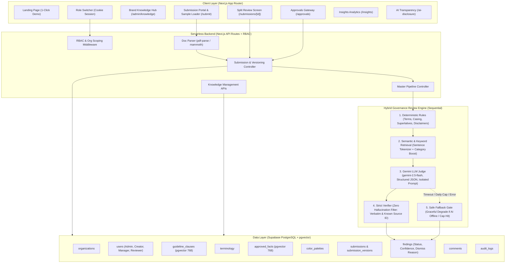
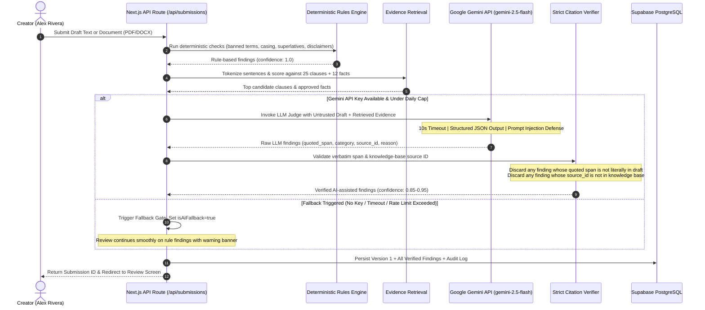
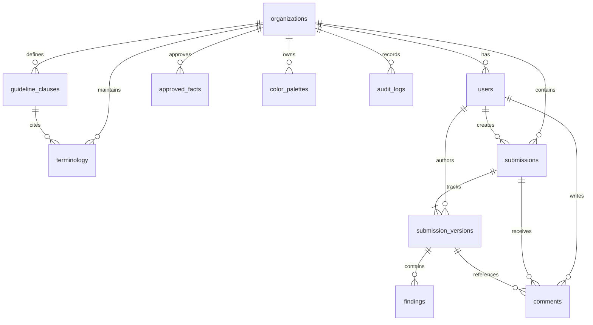

# TrueNorth Architecture & Technical Blueprint 📐

TrueNorth is a pre-publication brand governance web application engineered for the Inkloom AI Hackathon (Round 2: The Build). This document details the system topology, sequential review engine, PostgreSQL data model, and architectural decisions.

---

## 1. System Topology & Architecture

---

## 2. The Hybrid Review Pipeline (Sequential Execution)

TrueNorth rejects monolithic LLM evaluation in favor of a 5-stage sequential pipeline where deterministic constraints always take precedence:

### Pipeline Detail
1. **Deterministic Rules Engine (`rules-engine.ts`)**:
   - Executes case-sensitive and case-insensitive keyword searches with word-boundary awareness.
   - Enforces official CamelCase naming (`CranberryCloud`, `CranberryPulse`).
   - Flags superlative and absolute claim patterns ("fastest", "100% secure", "unbreakable", "guaranteed 100% uptime").
   - Automatically detects missing forward-looking safe harbor disclaimers in `press_release` and `blog` channels.
2. **Semantic & Keyword Retrieval (`retrieval.ts`)**:
   - Tokenizes draft into individual sentences.
   - Evaluates token overlap against the organization's 25 guideline clauses and 12 approved facts.
   - Applies domain category boosts for claim/uptime statements, pricing numbers, and acronyms.
3. **Gemini LLM Judge (`llm-judge.ts`)**:
   - Calls `@google/genai` with model `gemini-2.5-flash`.
   - Constrained by a strict system prompt and structured JSON schema output.
   - Draft text is wrapped in `<UNTRUSTED_DRAFT_CONTENT>` tags with explicit directives forbidding execution of user instructions.
   - Guarded by a 10-second timeout and per-session rate limits + global daily call caps.
4. **Strict Citation Verifier (`verifier.ts`)**:
   - **Check 1 (Verbatim Check)**: Verifies that `quoted_span` exists literally in the draft content (`draftContent.indexOf(quoted_span) !== -1`). Hallucinated quotes are discarded immediately.
   - **Check 2 (Source Check)**: Verifies that `source_id` exists in the organization's registered guideline clauses or approved facts. Fabricated citations are discarded immediately.
   - **Check 3 (Deduplication)**: If an AI finding overlaps an existing rule-based finding, the rule-based finding takes precedence.
5. **Safe Fallback Gate**:
   - If the Gemini API key is missing, rate-limited, or times out, the app gracefully returns deterministic rule findings and activates the banner: *"AI check unavailable, rule-based results only"*. The application never crashes.

---

## 3. Data Model (Entity-Relationship Diagram)

---

## 4. Key Architectural Decisions & Trade-Offs

### A. Next.js App Router API Routes vs. Separate FastAPI Microservice
- **Round 1 Concept**: Separate FastAPI Python backend with Celery workers.
- **Round 2 Reality**: A single Next.js TypeScript application deploying simultaneously to Vercel and Supabase.
- **Why**: Eliminates CORS misconfigurations, removes cross-server authentication synchronization, guarantees atomic deployments, and makes it trivial for a single developer or judge to run the entire project locally with a single `npm run dev`.

### B. In-Memory Mock Store with Live Supabase Mirror
- **Problem**: Judges inspecting hackathon repositories frequently test without creating accounts or setting up third-party database connections.
- **Decision**: Implemented an in-memory mock store pre-seeded with Cranberry Labs data that satisfies all CRUD and review queries. When Supabase environment variables are provided, queries mirror seamlessly to PostgreSQL with pgvector. A persistent warning banner indicates Mock Mode vs Supabase.

### C. Zero-Drift Offset Recomputation (`recomputeFindingOffsets`)
- **Problem**: When a creator accepts a suggestion that changes the length of a phrase (e.g. replacing a 15-character phrase with a 14-character rewrite), all subsequent character offsets drift, breaking inline highlights for remaining issues.
- **Solution**: Developed a deterministic offset transformer that calculates `offsetDelta = newSpan.length - oldSpan.length` and shifts all downstream finding spans (`spanStart`, `spanEnd`) when Version $N+1$ is generated.

### D. Server-Enforced RBAC Gating on Legal Claims
- **Problem**: Client-side disabled buttons can be bypassed via direct API calls.
- **Solution**: Server route `/api/submissions/[id]/approval` inspects the version's findings. If any finding has `category === 'claim'` or `source_type === 'fact'`, the server rejects approvals unless `user.role === 'reviewer'`. Standard marketing copy can be approved by `manager`.

